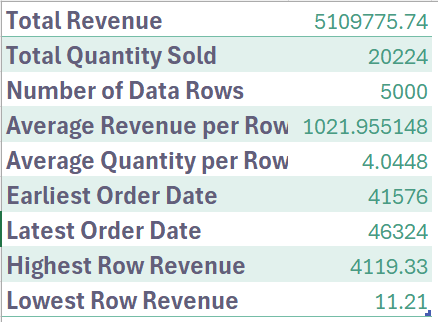
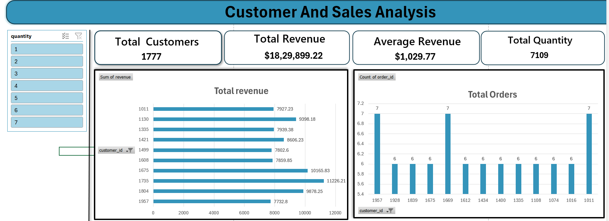
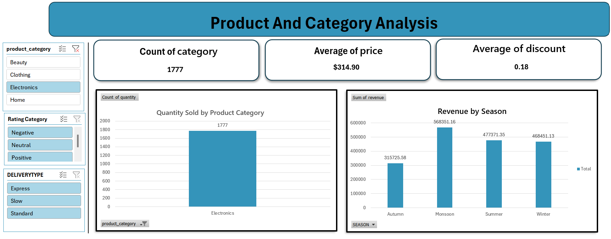
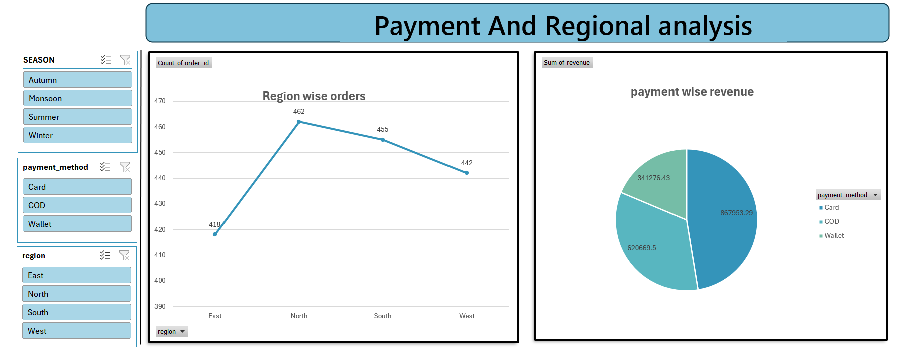
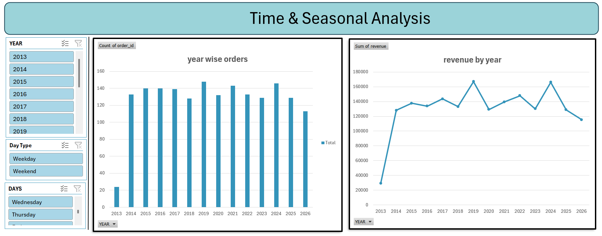

# 🛒 E-Commerce Sales Analytics

An end-to-end data analytics project that explores what drives e-commerce revenue: which products sell, who buys them, how discounts perform, and why customer satisfaction is low. The project covers data validation and feature engineering in Excel, business analysis with pivot tables, and an interactive Excel dashboard with slicers.

## 📌 Overview

Online retail teams need to know what drives revenue and how customers behave. This project analyzes **5,000 orders** from **989 customers** (29 Oct 2013 to 29 Oct 2026) to answer business questions across sales, customer behavior, discounts, delivery and payment, satisfaction, seasonality, and regions.

**Workflow:** Raw data → Validation & feature engineering → Exploratory analysis → Pivot-table dashboards → Insights & recommendations

## 📂 Dataset

| Property | Detail |
|---|---|
| Records | 5,000 (one per order) |
| Customers | 989 |
| Columns | 20 (12 raw + 8 engineered) |
| Period | 29 Oct 2013 to 29 Oct 2026 |
| Missing values | 0 nulls, 0 duplicate order IDs |

**Key columns:** `order_id`, `order_date`, `customer_id`, `product_category`, `region`, `quantity`, `unit_price`, `discount`, `revenue`, `payment_method`, `delivery_days`, `customer_rating`

**Engineered columns:** `YEAR`, `MONTHYEAR`, `DAYS`, `Day Type`, `SEASON`, `Revenue Category` (Low / Medium / High), `DELIVERYTYPE` (Express / Standard / Slow), `Rating Category` (Negative / Neutral / Positive)

## 🛠️ Tools & Technologies

- **Microsoft Excel:** data cleaning, formulas, pivot tables, charts and slicers
- **PowerPoint:** presentation deck
- **Git & GitHub:** version control

## 🔄 Project Steps

1. **Data loading:** Confirmed column types, a consistent date range, and no missing values.
2. **Data validation:**
   - Checked that all 5,000 order IDs are unique
   - Recalculated `revenue = quantity × unit_price × (1 − discount)` and matched every row
3. **Feature engineering:**
   - Extracted year, month, weekday and Weekday/Weekend labels from the order date
   - Grouped months into seasons (Winter, Summer, Monsoon, Autumn)
   - Banded orders by revenue, delivery time and rating
4. **Exploratory data analysis:** Summary statistics and correlations of numerical fields.
5. **Pivot-table analysis:** Built five analysis sheets with slicers (see below).
6. **Insights:** Grouped findings into seven business themes and wrote recommendations.

## 🔍 Analysis Themes

| Theme | Example questions |
|---|---|
| A. Sales & Revenue | Total revenue, revenue by category, revenue by order-size band |
| B. Customer Behavior | Repeat buyers, orders per customer, top customers, basket size |
| C. Discounts & Promotions | Discount level vs. order value, quantity and rating |
| D. Delivery & Payment | Delivery speed bands, payment method share and ratings |
| E. Customer Satisfaction | Rating distribution, ratings by category, region and payment |
| F. Time & Seasonal | Revenue by year, season, month and day of week |
| G. Regional | Revenue by region and category revenue by region |

## 📊 Dashboard

The Excel workbook `commerce_analysis.xlsx` lets you filter and explore revenue, customers, categories, payments, regions and time trends with slicers.

### Executive Summary


### Customer & Sales Analysis


### Product & Category Analysis


### Payment & Regional Analysis


### Time & Seasonal Analysis


> **Note:** the pivot tables are currently filtered to **Electronics** (1,777 orders, $1,829,899). Clear the `product_category` slicer to see the all-category figures used below.

## 📈 Key Results

| Metric | Value |
|---|---|
| Total revenue | $5,109,776 |
| Average order value | $1,021.96 |
| Unique customers | 989 |
| Revenue per customer | $5,167 |
| Average review rating | 2.97 / 5 |
| Repeat customers | 96.1% |
| Average discount | 18% |
| Negative ratings | 49.5% of orders |

**Insights**

- Electronics is the top revenue category ($1.83M, 35.8%), followed by Clothing (30.0%). Beauty is smallest but has the highest average order value ($1,059).
- The 25% of orders above $1,500 produce 54.8% of revenue, while the 35% under $500 produce only 8.9%.
- Most customers are loyal: 96% ordered more than once and the average is 5 orders. The top 10% contribute 21% of revenue.
- Deeper discounts lower revenue per order ($1,159 at 0 to 10% vs. $841 at 30 to 35%) without raising quantity or ratings.
- Satisfaction is the weakest area. Ratings barely change by category, region, payment method or delivery speed, so it is a business-wide issue.
- Orders and revenue are flat year over year (about 385 orders and $370K to $425K per year).
- Monsoon is the strongest season and November the strongest month. The four regions are balanced (24% to 26% each).
- Card accounts for 46% of revenue and COD for 35%.

## 💡 Recommendations

- Investigate the causes of low ratings (quality, listings, packaging, returns) and add a reason field to ratings.
- Test a lower discount cap or targeted discounts to protect margin.
- Use bundles and free-shipping thresholds to move Medium orders above $1,500.
- Launch a loyalty program for repeat buyers and re-engage one or two-time customers.
- Plan inventory and promotions around Monsoon and November peaks.

## 🗂️ Repository Structure

```
├── Data/
│   ├── Cleaned_Dataset.xlsx
│   └── ecommerce_sales_analytics_500...
├── images/
│   ├── customer-sales-analysis.png
│   ├── executive-summary.png
│   ├── product-category-analysis.png
│   ├── regional-payment-analysis.png
│   └── time-seasonal-analysis.png
├── Business Problem Statement.pdf
├── E-Commerce Sales Analytics Report.pdf
├── E-Commerce_Sales_Analytics.pptx
├── commerce_analysis.xlsx
├── LICENSE
└── README.md
```

## ▶️ How to Run

**1. Clone the repository**

```bash
git clone https://github.com/ARAGALAGOVARDHANREDDY/sales-trend-analysis-excel.git
cd sales-trend-analysis-excel
```

**2. Explore the Excel analysis**

- Open `commerce_analysis.xlsx` in Microsoft Excel.
- Go to the dashboard sheets and use the slicers (category, rating, delivery type, season, region, year) to filter the data.
- Raw and cleaned data are in the `Data/` folder.

**3. Read the findings**

- Full write-up: `E-Commerce Sales Analytics Report.pdf`
- Presentation: `E-Commerce_Sales_Analytics.pptx`

## 🚀 Future Improvements

- Forecast revenue with a time-series model
- Customer segmentation with RFM or clustering
- Predict low ratings using order, delivery and discount features
- Rebuild the dashboard in Power BI or Tableau

## 👤 Author

**Aragala Govardhan Reddy**
aragalavishnu30@gmail.com

⭐ If you found this project useful, consider giving it a star!
